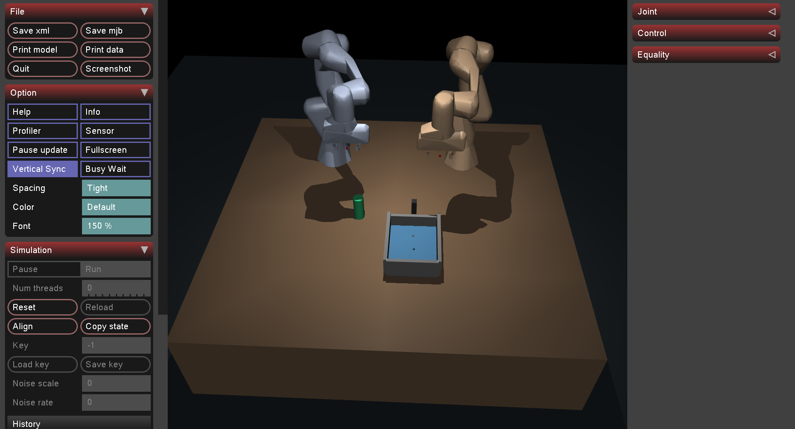

# Omni-VLA

> Repo map và tình trạng tài liệu: [docs index](./docs/README.md). Cấu trúc,
> cleanup policy và checklist refactor: [project map](docs/project/PROJECT_MAP.md).



**Bimanual Robot Manipulation with Flow Matching, RGB-D Affordances, and Contact-Rich Physics**

Omni-VLA is a research framework for dual-arm Franka Emika Panda manipulation in MuJoCo. It evaluates learned policies (Behavioral Cloning, Conditional Flow Matching, and Direct VLA) on multi-phase contact tasks (drawer opening, bottle transfer, and placement) without non-physical shortcuts (no teleportation or weld constraints).

Inference runs locally on CPU via ONNX; policy training scales on Kaggle GPUs.

---

## Key Highlights

* **Physics-Accurate Simulation**: Dual 7-DoF Franka Pandas under Cartesian Impedance Control ($500\text{ Hz}$ physics, $250\text{ Hz}$ torque control, $25\text{ Hz}$ policy actions).
* **Perception (P5 Student)**: Semantic RGB-D point-cloud regression replacing state oracles; achieves $0.29\text{ cm}$ visible mean error ($p95 = 0.83\text{ cm}$, CPU inference $p50 \approx 25.6\text{ ms}$).
* **Policy Architectures**:
* **BC v2 (Baseline)**: Reaches **84%** (42/50) success on fresh seeds under oracle context; **71%** (71/100) end-to-end with visual closed-loop P5.
* **CFM (Flow Matching)**: Continuous vector-field action chunking ($H=16$, Euler 4–8 steps; currently $52\text{--}60\%$).
* **Direct VLA**: Joint vision-language-history representation mapping directly to action chunks without task FSM or oracles.


* **Statistical Rigor**: Evaluations use paired, frozen seed suites (`plan.json`), exact McNemar tests, and Wilson 95% confidence intervals.

---

## System Architecture

```
[ Head RGB-D ] ---> [ P5 Point-Cloud Student ] ---> 3D Landmarks
                                                        │
[ Task Instruction + Proprioception (50-d) ] ──────────┼───> [ Policy: BC / CFM / VLA ]
                                                        │              │
                                                        │      [ Action Chunk (14-d) ]
                                                        │              │
                                                        ▼              ▼
                                          [ Cartesian Impedance Controller (250 Hz) ]
                                                        │
                                          [ MuJoCo Dual-Panda Physics (500 Hz) ]

```

---

## Quickstart

### 1. Installation (Local CPU)

Requires Python 3.10+ (tested on Python 3.12, Ubuntu).

```bash
git clone https://github.com/nguyenmarch/Omni-VLA.git
cd Omni-VLA

python3 -m venv .venv
source .venv/bin/activate
pip install torch --index-url https://download.pytorch.org/whl/cpu
pip install -e '.[train,deploy,test]'
pytest -q

```

### 2. Demonstration Collection

```bash
# Interactive GUI demo (3 episodes)
python -m scripts.collect_demonstrations --num-episodes 3 --gui --output data/gui_demo.h5

# Headless expert state dataset (150 episodes)
python -m scripts.collect_demonstrations --num-episodes 150 --output data/drawer_train.h5

# Headless RGB-D dataset collection (requires EGL/OSMesa)
MUJOCO_GL=egl python -m scripts.collect_demonstrations --num-episodes 20 --images --output data/rgbd_train.h5

```

### 3. Training on Kaggle

```bash
# Package source tree for Kaggle
python -m scripts.package_kaggle

# Inside Kaggle notebook (attach kaggle_source.zip & dataset):
python -m scripts.train_kaggle --dataset /path/to/dataset.h5 --policy bc --output /kaggle/working/bc
python -m scripts.train_kaggle --dataset /path/to/dataset.h5 --policy cfm --output /kaggle/working/cfm

```

### 4. CPU Evaluation & ONNX Export

```bash
# Export trained PyTorch weights to ONNX (batch=1)
python -m scripts.export_policy --checkpoint weights/bc_kaggle_v2/best.pt --output weights/bc_kaggle_v2/policy.onnx

# Run closed-loop benchmark (50 episodes)
python -m scripts.eval_closed_loop --checkpoint weights/bc_kaggle_v2/policy.onnx --episodes 50 --output artifacts/bc_eval.json

# Paired Visual Suite Benchmark (P5 + BC v2)
MUJOCO_GL=egl python -m scripts.evaluate_visual_suite run --output artifacts/p5_contact_transfer_suite

```

---

## Empirical Benchmark Status

All evaluations report exact successes over fixed seeds with Wilson 95% Score Intervals:

| Configuration | IID Success | Camera OOD | Lighting OOD | Position OOD | Primary Failure Mode |
| --- | --- | --- | --- | --- | --- |
| **Scripted Expert** | **99/100** (99.0%) | — | — | — | Kinematic edge cases |
| **State BC v2 (Oracle)** | **42/50** (84.0%) | — | — | — | Recovery from slip |
| **P5 Visual + BC v2** | **71/100** [61.5, 79.0]% | **10/20** (50.0%) | **10/20** (50.0%) | **5/20** (25.0%) | Timeout in `transfer` & `approach` |
| **CFM (Euler-8, H16)** | **26/50** (52.0%) | — | — | — | Trajectory drift in tight slots |

*Note: In the P5 Visual baseline, perception hard-rejections account for only $3\%$ of failures. Over $90\%$ of unresolved failures are controller timeouts during narrow-clearance bottle transfer and descend phases.*

---

## Repository Structure

```
Omni-VLA/
├── configs/        # Training hyperparameters (BC, CFM, Direct VLA)
├── models/         # Neural architectures (P5 Student, CFM, Impedance Controller)
├── simulation/     # MuJoCo scenes, Panda URDF/MJCF assets, and scripted FSM
├── scripts/        # Demonstration capture, Kaggle packager, ONNX export, and evaluation
├── tests/          # Geometry, kinematics, and physics regression tests
├── artifacts/      # Benchmark manifests (plan.json), evaluation reports, and traces
└── docs/           # Technical reports, diagnostic audits, and protocol notes

```

---

## License

Robot assets originate from [MuJoCo Menagerie](https://github.com/google-deepmind/mujoco_menagerie) under the [Apache-2.0 License](https://www.google.com/search?q=simulation/assets/panda/LICENSE). All original code is distributed under the MIT License.
