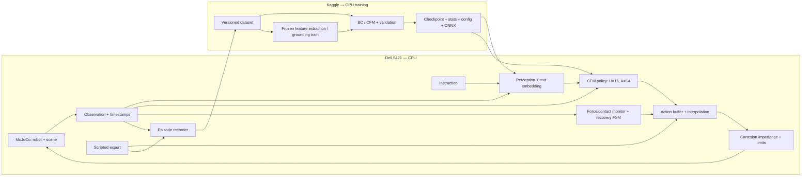

# Omni-VLA — kiến trúc cho Dell 5421 CPU + Kaggle

**Target architecture cập nhật 10/10/2026:** xem
[Advanced embodied control design](./ADVANCED_CONTROL_DESIGN.md) cho head 256/
wrist 224, robust depth, FK mask, correlated OT-CFM, learned monitor và recovery.
Phần khảo sát bên dưới là lịch sử trước implementation; xem status cho hiện trạng.

> Tài liệu thiết kế/khảo sát trước implementation. Xem [trạng thái hiện tại](./IMPLEMENTATION_STATUS.md) và README cho code, commands và kết quả đo mới.
Ngày khảo sát: 09/10/2026. Đây là thiết kế đề xuất, chưa phải hệ thống đã triển khai hay kết quả benchmark.

## 1. Phạm vi và quyết định chính

Mục tiêu cuối: hai tay giữ chai, tháo nắp, mở ngăn kéo, cất chai và đóng ngăn kéo với phản hồi lực. Xây theo hai tầng sản phẩm:

- **MVP chạy được:** hai tay robot, drawer pick/place, scripted expert, dataset, policy nhỏ và closed-loop evaluation trên CPU.
- **Research extension:** screw-cap approximation, visual-language affordance, flow matching, recovery và so sánh ablation.

MVP dùng trạng thái ground truth từ simulation để kiểm chứng control/data/policy; đây là baseline đặc quyền, chưa phải VLA. Chỉ gọi hệ thống là VLA khi inference thực sự nhận ảnh và instruction, không lấy vị trí vật thể thật từ simulator.

Dell đảm nhiệm simulation, demonstrations, inference và benchmark. Kaggle đảm nhiệm training và feature extraction GPU. Không cần streaming điều khiển giữa hai máy; trao đổi bằng dataset/checkpoint có version.

Python + MuJoCo là runtime ban đầu. ROS2/C++ là bước tích hợp sau khi rollout độc lập ổn định. Không đặt TPU/XLA, TensorRT hay mô hình ngôn ngữ lớn vào đường triển khai mặc định này.

## 2. Hiện trạng xác minh trong repository

| Thành phần | Quan sát thực tế | Hệ quả |
|---|---|---|
| Bản đề xuất tiền triển khai (đã bỏ khỏi repository) | Có lệnh TPU, cây thư mục và chỉ số chưa được code/experiment hỗ trợ | Dùng README và implementation status cho trạng thái thực tế |
| `simulation/assets/bottle_drawer_scene.xml` | MuJoCo 3.15.0 từ Python hệ thống báo schema error tại `<world>`; chưa có robot/actuator điều khiển hai tay | Phải dựng lại scene trước khi collect |
| XML hiện tại | Freejoint lồng trong body nắp, joint free + slide ở drawer, material `metal` chưa khai báo, sensor không hợp lệ | Sửa riêng `<world>` chưa đủ |
| `simulation/bimanual_env.py` | `mj_render`, `mj_encodePixels` không có trong MuJoCo đã kiểm tra; đọc `sensor_force` sai API; randomization trước reset; đường dẫn máy hardcode | Observation/reset chưa dùng được |
| Environment timing | `int(physics_dt / control_dt)` bị đảo; không reset `step_counter`; cấu hình 250 steps không được dùng đúng | Timing/truncation cần viết lại |
| Environment action | 14 giá trị đẩy thẳng vào `data.ctrl`; chưa có mapping Cartesian → torque | Chưa tồn tại impedance execution |
| `models/affordance_head.py` | Chưa tải DINOv2/text encoder; reshape `[B,768]` thành `[B,768,16,16]` không hợp lệ; conv tạo trong forward và sai channel; unprojection thiếu depth | Head cần thiết kế lại, chưa có grounding 3D |
| Policy/controller/dataset | Constructor placeholder và `NotImplementedError` | Chưa train hay rollout được |
| Collect/train/eval scripts | Chỉ in thông báo, chưa parse CLI hay chạy pipeline | Lệnh README chưa tái lập được |
| `ros2_ws/src`, `data`, `weights` | Trống tại thời điểm khảo sát | Chưa có ROS2 package/dataset/export artifact tại các thư mục này |
| `omni_vla_aloha_weights_3ep.pt` | Có file khoảng 49 MB ở root; chưa có metadata/loader tương ứng để xác minh | Không coi là checkpoint tương thích; cần kiểm tra schema, action và nguồn dữ liệu |
| Dependencies | Chưa có `requirements.txt`/`pyproject.toml`; `.venv` chỉ có pip. Python hệ thống có MuJoCo/Gymnasium, chưa có torch/h5py/onnxruntime | Chuẩn hóa môi trường trước implementation |

Không có log trong repo chứng minh latency <18 ms, success 89.6% hoặc mức tăng chất lượng so với diffusion. Những số này phải được ghi là mục tiêu hoặc bỏ khỏi bảng kết quả cho tới khi đo.

## 3. Sơ đồ hệ thống

### Simulation và controller

- Dùng hai Franka Panda fixed-base từ asset đã kiểm chứng; compose scene với prefix tên trái/phải, bàn, chai và drawer. Kiểm tra reachability, self-collision, actuator type và license từng asset. Menagerie là nguồn robot model đề xuất [S3].
- Drawer: một slide joint có giới hạn, handle và cavity thật để đặt chai; không kết hợp freejoint với slide trên cùng body.
- Chai: free body, collision hình học đơn giản. Bắt đầu từ thao tác drawer và pick/place rồi mới thêm nắp.
- Nắp ren: dùng mô hình cơ cấu xấp xỉ `z = pitch * theta / (2*pi)` trong fixture riêng, kiểm thử chuyển trạng thái attached/detached và tính liên tục pose/velocity. Chọn cơ cấu constraint/runtime transition sau spike kỹ thuật; không tuyên bố mô phỏng va chạm ren thật. Tiếp xúc ngón kẹp với chai/nắp vẫn phải qua physics.
- Controller sử dụng Jacobian ở end-effector site, sai số orientation trên SO(3), vận tốc Cartesian, bù bias dynamics và posture/null-space; giới hạn torque, tốc độ và workspace. Gripper điều khiển riêng. Gain phải phù hợp actuator thực tế, không dùng công thức torque với actuator position mà chưa đổi mapping.
- Force/torque sensor tại wrist site: đọc `sensordata` theo sensor address/dimension, giữ frame và đơn vị rõ ràng. Wrist wrench có cả ảnh hưởng gravity/dynamics; lọc/bù và kết hợp contact/gripper state khi phát hiện slip. Không thay sensor lỗi bằng zero một cách âm thầm.

API implementation đối chiếu tài liệu Python và MJCF chính thức [S1, S2]. Render dùng `mujoco.Renderer`, tạo một lần, đổi camera khi update scene; viewer dùng passive viewer. Có chế độ state-only để debug và collection control không tốn render.

### Nhịp chạy và tài nguyên CPU

Máy khảo sát báo i7-11850H, 8 cores/16 threads và RAM khoảng 16 GB. RAM khả dụng lúc kiểm tra khoảng 2.7 GiB; con số này thay đổi theo ứng dụng đang mở.

| Loop | Cấu hình ban đầu đề xuất | Điều kiện điều chỉnh |
|---|---|---|
| Physics | `dt=0.002 s`, 500 Hz theo simulation time | Kiểm chứng contact stability và real-time factor |
| Controller | 250 Hz, mỗi 2 physics steps | Nếu cần đúng 200 Hz, thử physics 1000 Hz (`dt=0.001`), mỗi 5 steps |
| Action timeline | 25 Hz, mỗi action là 40 ms simulation time | Chỉ đổi lên 50 Hz với model/data có cùng action_dt |
| Policy replan | Ban đầu mỗi 2 actions, tương đương 12.5 Hz | Giảm execute horizon khi latency cho phép |
| Perception | 2–5 Hz là mục tiêu thử nghiệm | Chọn theo end-to-end latency đo được |
| Render/log RGB-D | 10–25 Hz tùy chế độ | Gắn timestamp; policy biết tuổi của ảnh |

`H=16` tại 25 Hz phủ 640 ms; execute 2 actions rồi quan sát và replan. Không thực thi mù toàn bộ chunk. Interpolation đưa target về nhịp controller; clamp delta trước khi cộng vào pose.

Vòng sim/controller có một owner duy nhất của `MjData`. Worker inference nhận bản copy observation, trả chunk có timestamp và episode ID; latest-only buffer, bỏ kết quả trễ hoặc từ episode cũ. Khi target hết hạn: giữ pose an toàn hoặc chuyển recovery, không tiếp tục chunk cũ. Recovery xóa buffer và preempt policy.

Offline evaluation cho phép chạy chậm hơn thời gian thực, nhưng lịch update luôn theo simulation time. Báo real-time factor riêng; không coi 500 Hz simulation time là 500 Hz wall-clock đã đạt. Bắt đầu thread budget ONNX/PyTorch 2–4, một env và batch=1; đo contention rồi điều chỉnh. Headless CPU rendering thử OSMesa nếu EGL không khả dụng; benchmark ảnh riêng vì offscreen vẫn có chi phí.

### Observation/action contract

Không flatten ảnh vào một vector observation khổng lồ. Dùng Gymnasium `Dict` với shape thực tế được kiểm tra.

| Trường | Shape/ý nghĩa |
|---|---|
| RGB head, right wrist | Mỗi camera `uint8 [H,W,3]`; raw image 128 hoặc 224, resize/crop theo encoder version |
| Depth | Mỗi camera `float32 [H,W]`, đơn vị mét, có invalid mask |
| Camera calibration | Intrinsics K và extrinsics world-from-camera theo từng frame; wrist camera gắn robot |
| q, dq | Mỗi trường 14: 7 arm joints × 2; không chứa freejoint vật thể |
| Gripper state | Opening/velocity trái và phải, quy ước đơn vị rõ ràng |
| Wrench | `[12]`: force XYZ + torque XYZ cho từng wrist; N và N·m, cùng frame quy ước |
| Time/context | Simulation timestamp, image timestamp/age, instruction ID/text, phase estimate |
| Action | `[14]`: trái `[dx,dy,dz,rx,ry,rz,g]`, phải tương tự |

14 action coordinates là **hai delta pose 6D + hai gripper commands**, không đồng nghĩa 14 joint torques. Translation tính bằng mét ở world frame; rotation vector rad ở world frame với phép cập nhật `R_target = Exp(dr) @ R_current`; `g` là desired opening normalized [0,1]. Điều chỉnh tốc độ gripper trong executor. Lưu `action_dt`, limits và frame convention trong metadata.

Condition của baseline ground-truth gồm object pose/task phase cùng robot state. Condition của learned VLA gồm `z_aff`, text embedding, q/dq, hai wrench, gripper state và context. Dimension suy ra từ schema/config thay vì cố định 290. Không cấp ground-truth phase/object pose cho VLA evaluation; phase phải do task executor/observation estimate tạo, ghi rõ ablation nếu dùng oracle.

## 4. Perception và language

MVP dùng finite instruction set và embedding nhỏ để kiểm thử pipeline. Mức research dùng frozen text encoder cho instruction/paraphrase và projector sang dimension của image features. DINOv2 là visual encoder; phải bổ sung đường language conditioning và supervision.

Đề xuất hai cấu hình để đo trên Dell:

1. **CPU default:** CNN nhỏ hoặc student distilled từ frozen visual teacher; dự đoán heatmap theo task và latent 64–128D.
2. **Research reference:** DINOv2-S/14 frozen + grounding head; chỉ dùng B/14 nếu ngân sách đo được phù hợp. Model S/B chính thức có khoảng 21M/86M parameters [S4]. Đây là lựa chọn cần benchmark, chưa bảo đảm tần số.

Head phải giữ trục spatial: image patches `[B,N,D]` → text-conditioned patch features → heatmap trên patch grid, hoặc aggregate attention thành `[B,N]`. Không reshape text token thành spatial grid. Huấn luyện keypoint/heatmap bằng target site từ simulation, đánh dấu visibility và không ép label cho điểm bị che.

3D unprojection dùng depth tại contact pixel: `p_cam = depth * K^-1 [u,v,1]`, sau đó extrinsics → world. Thống nhất convention camera MuJoCo và CV, kiểm thử projection/unprojection với site đã biết. Thêm confidence; không dùng depth=1 giả định cho điểm tiếp xúc chính xác.

Cache frozen image tokens trên Kaggle giúp giảm chi phí training; student/head train được không cache latent trước khi model cố định. Cache kèm encoder hash, preprocessing và dataset version. Cache training không loại bỏ nhu cầu encode ảnh mới ở inference local.

## 5. Policy và learning

Baseline đầu: behavior cloning MLP từ cùng condition/action schema, giúp tìm lỗi data/controller trước flow matching.

CFM đầu: vector field MLP residual, flatten chunk `[16,14]` thành 224 values, sinusoidal time embedding, condition projection, hidden 256 rồi thử 512. Sinh noise cùng shape, Euler 4/6/8 steps. Đo runtime toàn sampler, gồm tất cả bước vector field và preprocessing.

Training đơn giản:

`x0 ~ N(0,I), t ~ U(0,1), xt=(1-t)*x0+t*x1`

`loss = masked_MSE(v_theta(xt,t,c), x1-x0)`

Đây là CFM với independent pairing. Chỉ gắn nhãn OT-CFM khi triển khai matching OT và kiểm chứng. TorchCFM phân biệt hai variant này [S5]. Với conditional dataset, nếu OT đổi index x1 thì condition/mask/label phải đi theo x1 đó; thử matching trong nhóm task/phase tương đồng, tránh ghép hành động khác ngữ cảnh. OT là experiment riêng, không phải điều kiện để MVP chạy được.

Norm thống kê chỉ fit trên train episodes; normalize continuous state/action, không normalize categorical ID như số liên tục. End-of-episode chunk padding có mask trong loss/metric. Không tạo chunk xuyên episode. Model selection dựa trên rollout đã định nghĩa, không chỉ train loss. Euler ít bước không tự bảo đảm trajectory mượt: kiểm tra velocity, acceleration, jerk và contact spikes.

## 6. Data và vòng làm việc Dell ↔ Kaggle

Mỗi episode trong HDF5 shard có observations, actions, timestamps, instruction, phase label cho training, ground-truth sites/visibility, seed/randomization parameters và success/failure reason. Lưu ảnh uint8 và depth có quy ước; ghi tăng dần, không giữ toàn dataset trong RAM.

Split train/val/test theo **episode và scene seed**, không split overlapping chunks. Cố định test manifest trước tune; thêm OOD set cho ma sát/vị trí/lighting ngoài train range. Dataset manifest lưu schema version, scene hash, controller version, camera calibration convention, action_dt và checksums.

Ước lượng để sizing, chưa tính compression/depth: 150 episodes × 30 s × 25 Hz = 112,500 frames. Hai ảnh RGB 224² chiếm khoảng 33.9 GB raw; ở 128² khoảng 11.1 GB. Không hứa ≤5 GB nếu chưa đo. Có thể giảm image rate, nén hoặc shard 0.5–1 GB, nhưng phải lưu timing để reconstruct observations đúng.

Quy trình:

1. Dell collect → validate → tạo train/val/test manifests → upload dataset version.
2. Kaggle đọc dữ liệu input; pin code/dependencies; detect accelerator/VRAM trước chọn batch/dtype.
3. Smoke train batch 16–32, rồi thử 64–128 khi memory cho phép; FP32 fallback và AMP theo GPU thực tế. Một GPU trước, thêm DDP sau khi có bằng chứng cần thiết.
4. Ghi outputs/checkpoints vào `/kaggle/working`, Save Version có outputs để lấy artifact. Cấu hình/quota accelerator phải kiểm tra ở session thực tế, không giả định TPU v5e-8 hoặc GPU cố định [S6].
5. Checkpoint gồm weights, optimizer, scheduler, scaler, epoch/global step, RNG, config, normalization, dataset hash và best metric. Lưu mỗi epoch hoặc khoảng 10–15 phút; kiểm thử resume.
6. Export vector field ONNX + Euler wrapper hoặc export sampler với K cố định. Bundle encoder/head/text artifacts nếu inference dùng chúng; có PyTorch CPU fallback. Test parity với **cùng input và noise**, không so hai random trajectories.
7. Dell load artifact → verify schema → rollout fixed test set → report/version → iteration tiếp theo.

File ALOHA hiện có cần audit bằng loader an toàn trong môi trường PyTorch: keys/shapes, architecture, action representation, normalizer và encoder. Chỉ transfer phần có mapping tương thích; không dùng file này để bỏ qua việc train task-specific policy.

## 7. Recovery và đo lường

FSM đề xuất: `APPROACH → GRASP → MANIPULATE → RELEASE → DONE`, nhánh `HOLD → REGROUND → REGRASP`, timeout → `FAILED`. Mỗi skill có precondition/postcondition. Slip dựa trên contact change, gripper opening, relative motion và wrench đã lọc; threshold có hysteresis và giới hạn retry. Success label evaluator có thể dùng ground truth nhưng policy không được đọc evaluator state.

Đo ít nhất:

- Success từng subtask và full task; denominator/failed episodes/retries rõ ràng, confidence interval cho tỷ lệ.
- Wrench peak, tracking error, collision/workspace violations và lý do fail.
- Latency p50/p95 cho render, perception, sampler, controller và end-to-end; warmup, thread count, CPU-only và model config.
- Real-time factor, deadline misses, observation age và RAM peak.
- IID test ban đầu 50 episodes; bản report cuối tối thiểu 100 IID và 50 OOD nếu chi phí cho phép, nhiều training seeds.
- Ablation cùng split/controller: BC vs CFM; state oracle vs vision; recovery off/on; Euler 4/6/8. OT và ACT/diffusion chỉ thêm nếu đủ ngân sách.

Mục tiêu success ≥80% cho drawer MVP và ≥85% full-task là **stretch targets** sau integration. Không xem là kết quả đã đạt; screw-cap fidelity và chất lượng expert có thể quyết định lại lịch/phạm vi.

## 8. Nguồn kỹ thuật

- [S1: MuJoCo Python](https://mujoco.readthedocs.io/en/stable/python.html)
- [S2: MuJoCo MJCF XML reference](https://mujoco.readthedocs.io/en/stable/XMLreference.html)
- [S3: MuJoCo Menagerie](https://github.com/google-deepmind/mujoco_menagerie)
- [S4: DINOv2 models](https://github.com/facebookresearch/dinov2)
- [S5: TorchCFM variants](https://github.com/atong01/conditional-flow-matching)
- [S6: Kaggle Notebooks](https://www.kaggle.com/docs/notebooks)
