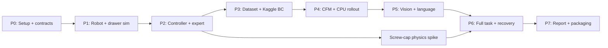

# Omni-VLA — build plan

## Advanced migration — 10/10/2026

Pilot mới: [P5_PERCEPTION.md](../p5/P5_PERCEPTION.md); patch v3 là baseline cũ
trong [PATCH_GROUNDING_V3.md](../perception/PATCH_GROUNDING_V3.md).

Đặc tả/gates: [ADVANCED_CONTROL_DESIGN.md](./ADVANCED_CONTROL_DESIGN.md).
Mục tiêu >=90% là target mới, chưa đạt. BC giữ làm baseline kiểm soát khi
migration; production target dùng correlated OT-CFM được nghiệm thu.

| Stage | Công việc | Trạng thái |
|---|---|---|
| A1 | Patch depth, workspace/invalid gates; migrate offset labels/schema, train/eval | Patch v3 chưa đạt; P5 RGB-D student đạt gate định vị offline trên test, closed-loop ≥90% chưa chứng minh |
| A2 | Head 256 + wrist 224 riêng; async render snapshots; Pinocchio/CAD self-mask, fusion | Sync head256/wrist224 + MuJoCo FK mask audit có; Pinocchio, per-camera training/fusion và async còn thiếu |
| A3 | Learned semantic predicates; tách perception/monitor lỗi; loại oracle task phase | Chưa làm |
| A4 | Correlated Gaussian H16/A14, OT matching/conditioning; visual-language policy, Euler 2/4/6 | Chưa làm; không đổi tên CFM cũ thành OT |
| A5 | Perturbation/recovery data + policy; force feedback adaptive impedance/cap torque stop | Chưa tích hợp đầy đủ |
| A6 | ONNX full-path parity <1e-5; CPU latency/deadline gates; ROS2 contracts/packages | Export state-policy cũ có; advanced path chưa có |

Chuyển stage theo correctness/coverage và rollout gates, không dựa vào loss
hay module unit tests. Gate >=90% đo riêng từng task và held-out seed set;
không dùng success oracle/expert fallback trong production benchmark.

Các milestone P0–P6 bên dưới giữ lại làm lịch sử kế hoạch ban đầu.

> Tài liệu thiết kế/khảo sát trước implementation. Xem [trạng thái hiện tại](./IMPLEMENTATION_STATUS.md) và README cho code, commands và kết quả đo mới.
Kế hoạch dựa trên khảo sát ngày 09/10/2026 và [architecture](./ARCHITECTURE.md). Phần lớn repository hiện là scaffold; khối lượng đầu tiên là dựng simulation/controller/data đúng, không phải chỉ chạy training.

Ước lượng một người làm: **4–6 tuần cho MVP drawer + learned policy**, **thêm 3–6 tuần cho screw-cap + visual-language + recovery**. Đây là khoảng lập kế hoạch, chưa biết tốc độ expert development, Kaggle quota và simulation throughput. Các tuần có thể chồng lấp; chỉ chuyển milestone khi đạt gate. Nếu chỉ có 4 tuần, scope demo là drawer task + CFM/state baseline; phần VLA và uncapping ghi roadmap.

## 1. Thứ tự triển khai



## 2. Milestones và acceptance gates

| Milestone | Ước lượng | Deliverables | Gate để chuyển bước |
|---|---|---|---|
| P0 — môi trường/contracts | 1–2 ngày | Dependencies local/train, schema obs/action, config loader, path portability, smoke entrypoint | Cài trong clean env; import module; config và shape validation chạy được từ ngoài repo root |
| P1 — sim hai tay/drawer | 3–5 ngày | Robot assets, MJCF hợp lệ, cameras/sites/sensors, reset và Gym Dict | Scene compile; 10,000 physics steps không NaN/divergence; seeded reset reproducible; observation đúng space |
| P2 — controller/expert | 4–7 ngày | Controller, limits, scripted skill FSM, success predicates | Free-space tracking error RMS mục tiêu <1 cm; drawer expert thành công ≥95/100 randomized trials; record failures |
| P3 — data/BC trên Kaggle | 3–5 ngày | Collector, HDF5 shards, manifests, dataset loader, BC train/resume | 20 episodes pilot đọc được end-to-end; không chunk qua episode; train-only normalization; overfit 5–10 demos; resume khôi phục progress |
| P4 — CFM và deployment CPU | 4–7 ngày | Vector field, sampler, train/eval, artifact exporter | Shapes/loss đúng; 4/6/8-step sampling finite; ONNX parity đề xuất max abs error ≤1e-4 FP32; 50 held-out closed-loop rollouts có report |
| P5 — perception/language | 5–10 ngày | Teacher/head hoặc student, text encoder, RGB-D/camera transforms | Visible-site 3D error mean mục tiêu ≤1.5 cm, báo p95/occlusion; image/text ablations; held-out paraphrases; đo CPU throughput |
| Cap spike — screw mechanics | 3–7 ngày, có thể kéo dài | Fixture, attached/detached transition, torque/release tests | z–theta relation đúng trong tolerance đã định; detach không discontinuity lớn; không teleport chai/nắp trong expert; fail thì giới hạn demo ở drawer |
| P6 — full task/recovery | 5–10 ngày | Expert toàn task, data bổ sung, retrain, preempt/regrasp | Mỗi phase có predicate; forced slip ngắt chunk cũ và recovery được kiểm chứng trên fixed scenarios; success/fail/retry report |
| P7 — reproducibility/demo | 2–4 ngày | Clean quickstart, benchmark artifacts, videos, model card | Clean install → collect pilot → train smoke → CPU eval; mọi chỉ số README truy được tới report/config/checkpoint |

Các ngưỡng trong gate là mục tiêu nghiệm thu đề xuất. Tracking tolerance/gain cần tune theo robot; ONNX tolerance phải điều chỉnh và ghi rõ nếu dùng quantization. P4 chưa yêu cầu <18 ms; yêu cầu đo latency để quyết định nhịp rollout.

P5 đã có teacher segmentation replay-certified, RGB-D student, text encoder,
ablation, held-out paraphrases và CPU benchmark. Test visible mean **0,29 cm**,
p95 **0,83 cm**, coverage **423/423**; xem [báo cáo P5](../p5/P5_PERCEPTION.md).
Kết quả này chỉ đóng gate định vị trong scene hiện tại; system success ≥90%,
OOD và wrist fusion tiếp tục ở các stage sau.

## 3. Công việc cụ thể theo file

### P0: nền tảng

- Thêm `pyproject.toml` với nhóm dependency simulation/training/inference; pin môi trường Kaggle đã smoke test và lưu versions. Local CPU PyTorch chỉ cần khi dùng PyTorch inference/export validation.
- Config tách `physics_dt`, `controller_hz`, `action_hz`, `execute_horizon`, `perception_hz`, `max_episode_seconds`; validate tỷ lệ timing.
- Path bằng project-relative/resource path, không chứa `/home/nguyen-cong/...` trong runtime.
- Thêm typed schema, frame/units metadata và random seeds. CLI thực sự parse config/checkpoint/episodes.
- README sửa commands sang GPU Kaggle và artifact format hỗ trợ; bảng số liệu đổi thành targets cho tới khi có kết quả.

### P1–P2: simulation trước learning

- Thay scene XML; robot trái/phải có actuator/sensor names rõ ràng; kiểm tra mass/inertia/friction.
- Viết lại `simulation/bimanual_env.py`: Dict observation, cached renderer, sensor address indexing, arm joint address indexing, reset rồi randomize rồi forward, reset counter.
- Với action 25 Hz và physics 500 Hz: advance 20 physics steps/action; controller update mỗi 2 steps. Render theo lịch riêng, timeout theo sim time.
- Implement `models/impedance_controller.py` với position/orientation error, Jacobian, torque saturation, bias compensation, gripper adapter.
- Thêm evaluator success cho drawer open, grasp/release, object inside cavity, drawer close; full task nối predicates tuần tự.
- Expert dùng cùng action adapter/controller như policy; không điều khiển bằng sửa trực tiếp qpos object trong episode. Ground truth cho expert được lưu như privilege.

### P3: dataset và baseline

- Implement `scripts/collect_demonstrations.py` với CLI, seed sweep, append streaming và episode finalization. Failed demos không trộn thành positive labels; giữ failure logs.
- Implement `utils/dataset.py`: split episode, train statistics, chunk indexing, padding masks và lazy HDF5 handle mỗi DataLoader worker.
- 20 episodes pilot trước; khi expert gate pass mới collect 150–300 episodes, cân bằng phase và randomization. Scale dataset dựa trên learning curve, không coi 150 episodes tự bảo đảm đủ.
- Thêm BC model/train option, validation và metrics. Kiểm tra alignment obs_t → action_t, thời gian ảnh, action units và gripper polarity khi baseline thất bại.

### P4: flow matching

- Implement `models/flow_matching_policy.py`: time embedding, conditional residual MLP, output `[B,H,14]`, deterministic seeded Euler sampler.
- Implement `scripts/train_kaggle.py`: CLI/config, train/val separation, masks, optimizer/scheduler, AMP có fallback, checkpoint resume và artifact metadata.
- CFM độc lập trước; OT là tùy chọn sau với index condition theo matched target. Thêm numerical sanity checks cho vector field/sampler.
- Thêm export utility, normalizer/config/encoder manifest; CPU artifact verification phải cùng input/noise.
- Implement `scripts/eval_closed_loop.py`: PyTorch/ONNX loader, chunk buffer, receding horizon, timestamps, success evaluator và JSON/CSV report.
- Khởi đầu một process sim với inference synchronous offline để correctness; thêm asynchronous worker khi correctness pass, sau đó đo real-time/deadlines.

### P5–P6: VLA và contact-rich extension

- Dựng affordance head trên image patch axis; depth/extrinsics thật; text projection/conditioning và supervised grounding loss.
- Train frozen-teacher head trên Kaggle, thử student CPU nếu teacher chậm. Feature-cache invalidation theo hash.
- Test phản ứng khi đổi instruction và ảnh; báo khả năng trên finite task set, không suy rộng thành open-world language understanding.
- Thêm screw fixture rồi full task scene; tăng episode duration phù hợp uncapping, không mặc định 250 actions/10 s đủ cho mọi task.
- Full-task expert cần deposit cap, open drawer, transfer bottle và close drawer; retrain theo data distribution mới.
- Force/contact monitor có filtering, hysteresis, retry budget; recovery preempt buffer, hold/reground/regrasp. Dữ liệu recovery thu riêng và dùng retrain nếu muốn policy xử lý trạng thái lỗi.

## 4. Layout bổ sung đề xuất

Giữ các module hiện tại, thêm file khi milestone cần đến:

```text
docs/docs/project/ARCHITECTURE.md             # đã tạo: thiết kế
docs/docs/project/BUILD_PLAN.md               # đã tạo: milestone và gates
pyproject.toml                  # P0
configs/eval_cpu.yaml            # P0/P4
simulation/action_adapter.py    # P2: delta pose → controller targets
simulation/task_evaluator.py    # P2: success predicates
simulation/expert.py            # P2: scripted skills
utils/schema.py                 # P0: shape/units/version
utils/checkpoint.py             # P3/P4: metadata + resume
models/bc_policy.py              # P3
scripts/validate_dataset.py      # P3
scripts/export_policy.py         # P4
scripts/profile_cpu.py           # P4/P5
tests/                          # kiểm tra correctness thiết yếu
artifacts/<run_id>/              # reports, configs, seeds, manifests
notebooks/kaggle_train.ipynb     # wrapper của training CLI
```

Đây là layout dự kiến; ngoài hai tài liệu `docs/`, các file mới chưa được triển khai. Không tạo ROS2 packages trước P6 chỉ để khớp cây thư mục trong tài liệu cũ.

## 5. Verification cần thiết

- **Simulation:** compile MJCF, timing, seeded reset, Dict space containment, wrench dimensions, object placement và no-NaN rollout.
- **Geometry/controller:** camera round-trip projection, SO(3) error convention, torque/action limits, tracking và known-force fixture.
- **Data:** episode split disjoint, no boundary leakage, correct time alignment, norm serialization, tail mask và integrity checks.
- **Learning/deploy:** batch overfit, finite samples, resume parity, PyTorch/ONNX cùng-noise parity và end-to-end load trên CPU.
- **System:** recovery preemption, stale chunk rejection, fixed held-out rollouts và timing under rendering load.

Không cần test mọi dòng code; ưu tiên các lỗi có thể làm benchmark sai dù chương trình vẫn chạy.

## 6. Ngân sách và điểm quyết định

| Rủi ro | Cách giảm và quyết định |
|---|---|
| CPU perception quá chậm | Benchmark CNN/student và DINO-S trước; giảm perception rate/resolution theo train config, giữ controller cadence; báo ảnh hưởng tới success |
| RAM/data quá lớn | UInt8 RGB, streaming HDF5, shard, ít workers; đo peak RSS; resize/rate đi cùng metadata |
| Kaggle session/quota thay đổi | Detect GPU lúc khởi động, single-GPU baseline, resume checkpoint; lưu version outputs; không cam kết runtime trước pilot |
| Policy loss đẹp nhưng rollout fail | Audit obs/action alignment, normalization, action_dt và controller; dùng BC/oracle baseline phân lập lỗi |
| Screw-cap physics tốn thời gian | Spike fixture có timebox; nếu gate fail, ship drawer demo trước và công bố fidelity limitation |
| Checkpoint ALOHA không khớp | Audit keys/shapes/schema trước transfer; train lại nếu không tương thích |
| OT không cải thiện | Báo CFM đúng tên; giữ OT ablation riêng với matched condition và cùng split |
| ROS2 tăng overhead | Tích hợp sau pipeline Python; đo queue age/drop/deadline và dùng latest-only QoS phù hợp |

Ưu tiên ngay: **P0 → P1 → controller/expert P2**. Chạy được 100 expert trials đáng tin cậy là nền tảng để quyết định có nên dành GPU quota cho training. Sau P4 có demo learned control kiểm chứng trên CPU; sau P5 mới có cơ sở đánh giá VLA.

Nguồn cho API, accelerator workflow và model variants nằm trong [architecture](./ARCHITECTURE.md#8-nguồn-kỹ-thuật). Các lịch, tốc độ chạy và acceptance targets trên đây là đề xuất kỹ thuật, chưa phải benchmark.
